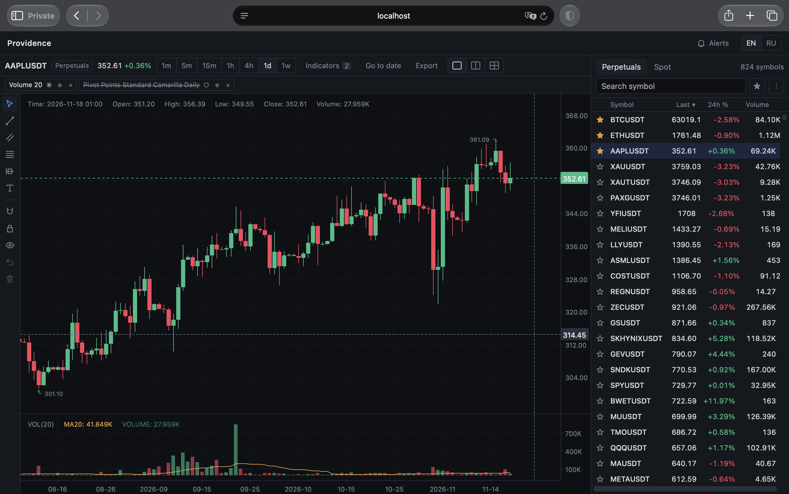

# Providence

**A free, open-source trading analysis platform — for traders, developers and analysts.**

Charts, indicators, drawing tools and alerts that run entirely on your own computer. No account, no subscription,
no ads, no telemetry. Just `docker compose up` and start analysing.



> [!note]
> Providence is young (v0.1). Today it covers crypto and tokenised assets from Bybit's public market data. More data
> sources and modules are on the [roadmap](#roadmap).

## Why Providence?

Great charting tools exist, but most are closed, cloud-based and paywalled, and you can't change how they work.
Providence takes a different path:

- **Free forever.** MIT-licensed. Every feature is available to everyone.
- **Yours.** Runs locally; your drawings, layouts and alerts live in a SQLite file on your machine.
- **Hackable.** TypeScript end to end. Indicators and drawing tools are small modules you can read, copy and change.
- **Modular.** A small core plus extension points (data adapters, indicators, drawing tools, panels, alert channels),
  so new features grow as plugins instead of a monolith.

### Who is it for?

| You are… | Providence gives you… |
|---|---|
| a **trader** | a clean chart, the indicators and drawing tools you use daily, and alerts that work with the tab closed |
| an **algo trader** | a local place to look at your data, and (soon) a way to connect and control your own bot |
| a **developer** | a readable React + Fastify codebase where a new indicator is one TypeScript file |
| an **analyst** | history on any timeframe, CSV/JSON export with indicator values, screenshots |

### How it compares

TradingView and MetaTrader are mature products built by large teams. Providence isn't trying to beat them on
breadth; it aims to be the free, open and self-hosted option.

| | Providence | TradingView | MetaTrader 4/5 |
|---|---|---|---|
| Price | free, all features | free plan with limits, paid plans | free, usually through a broker |
| Source code | open (MIT) | closed | closed |
| Where it runs | your computer (browser + local server) | cloud / web | desktop app |
| Account needed | no | yes | broker account |
| Your data | stays local | on their servers | broker / local |
| Extending it | TypeScript modules, fork anything | Pine Script | MQL |
| Markets today | Bybit (crypto, tokenised stocks & metals) | very broad | depends on broker |
| Social features | none (by design) | yes | limited |

## Features

- **Markets list** — Bybit USDT perpetuals and spot with last price, 24h change and volume (turnover and funding as
  optional columns); search, sort, favourites pinned to the top, refreshed every 5 s.
- **Charts** — candles on 1m, 5m, 15m, 1h, 4h, 1d, 1w; scroll back through history (loaded on demand), go to a date,
  live last candle; zoom the price axis by dragging it or with the mouse wheel.
- **Indicators** — SMA, EMA, Bollinger Bands, Parabolic SAR, VWAP, Pivot Points Standard on the chart; Volume, MACD,
  RSI, Stochastic, ATR, CCI, OBV in their own panes. Editable parameters, show/hide, up to 10 per chart.
  Custom indicators are plain TypeScript files in `packages/indicators`.
- **Drawing tools** — trend lines, rays, horizontal/vertical lines, channels, Fibonacci retracement and channel,
  long/short position with live R:R and %, price and date ranges, text, annotations, arrows. Restyle, lock, delete,
  undo (Ctrl/Cmd+Z). Drawings are saved per symbol and shared across timeframes.
- **Layouts** — 1, 2 or 4 charts, each with its own symbol, timeframe and indicators.
- **Alerts** — price crosses / rises above / falls below, price crosses a drawn line, indicator value on candle close
  (RSI, EMA, SMA, ATR). Once or every time, optional expiry, history. Evaluated by the local server, so they keep
  working with the browser tab closed; delivered in the app and as a macOS notification.
- **Export** — candles as CSV, candles + indicator values as JSON, chart screenshot as PNG; exported JSON can be
  opened again for viewing.
- English and Russian interface, dark theme.

## Quick start

### Option 1: let an AI assistant install it

Paste this into Claude Code (or any coding assistant that can run commands on your machine):

```text
Install and start Providence for me from https://github.com/<your-github-user>/providence.
1. Check whether Docker is installed and running. If yes: clone the repo, run `docker compose up -d --build`
   in it, wait until http://localhost:4317 responds, and tell me to open it.
2. If Docker is not available: check for Node.js 22+ (install it if missing, e.g. via nvm or Homebrew),
   run `corepack enable pnpm`, clone the repo, then `pnpm install`, `pnpm build` and `pnpm start`,
   and tell me to open http://localhost:4317.
3. Do not expose the port to the network (bind to 127.0.0.1 only) and do not change any config defaults.
If a step fails, show me the error and suggest a fix before trying anything else.
```

### Option 2: three commands

```bash
git clone https://github.com/<your-github-user>/providence.git
cd providence
docker compose up -d --build
```

Open http://localhost:4317. Details and the no-Docker setup are below.

## How it works

```
Browser (React + KLineChart)  ──REST /api──▶  Local server (Fastify + SQLite)  ──▶  Bybit public REST
        │                     ◀──WS /events── (alerts)          │
        └── live candles ──▶ Bybit public WebSocket              └── alert engine ──▶ Bybit public WebSocket
```

- The **server** proxies and caches Bybit REST (symbols 1 h, tickers 5 s, closed candles permanently in SQLite),
  stores settings, layouts, drawings and alerts, and runs the alert engine.
- The **web app** draws charts with [KLineChart](https://github.com/klinecharts/KLineChart) 9 and gets live candles
  straight from Bybit's public WebSocket.

| Path | What it is |
|---|---|
| `apps/web` | React + Vite web app |
| `apps/server` | Fastify server, SQLite store, candle cache, alert engine |
| `packages/core` | shared types and maths (indicators, alerts, position R:R, pivots) |
| `packages/adapter-bybit` | Bybit REST/WebSocket client and data mapping |
| `packages/indicators` | custom indicators |
| `docs/` | feature specs and decisions |

## Run with Docker

Requires Docker (Docker Desktop, OrbStack, Colima…).

```bash
docker compose up -d --build
```

Open http://localhost:4317. Data (settings, drawings, alerts, candle cache) is kept in the `providence-data` volume.

Without Compose:

```bash
docker build -t providence .
```

```bash
docker run -d --name providence -p 127.0.0.1:4317:4317 -v providence-data:/data providence
```

Stop with `docker compose down` (or `docker stop providence`); the data volume is kept.

> [!important]
> Publish the port on `127.0.0.1` as shown. Providence has no login; publishing on all interfaces would let anyone on
> your network change your settings and alerts.

In Docker, alerts still fire and show up in the app, but **macOS notifications are not available** — a container
cannot reach the Mac's Notification Center. Run Providence without Docker if you want system notifications.

## Run without Docker

Requires **Node.js 22+** and **pnpm** (`corepack enable pnpm`).

```bash
pnpm install
```

**Use it** (production build, one process):

```bash
pnpm build && pnpm start
```

Open http://localhost:4317.

**Develop** (hot reload, web on :5173 + server on :4317):

```bash
pnpm dev
```

Open http://localhost:5173.

### Configuration

Optional: copy `apps/server/config.example.json` to `apps/server/config.json`.

| Key | Default | Meaning |
|---|---|---|
| `port` | `4317` | server port |
| `dbPath` | `./data/providence.db` | SQLite file (relative to `apps/server`) |
| `bybit.restHost` | `https://api.bybit.com` | Bybit REST host |
| `bybit.wsHost` | `wss://stream.bybit.com` | Bybit WebSocket host (alert engine) |

Environment variables `PROVIDENCE_PORT`, `PROVIDENCE_DB_PATH` and `PROVIDENCE_WEB_DIR` (folder of the built web app
to serve) override the file. Outside Docker the server only ever listens on `127.0.0.1`.

### macOS notifications

macOS only shows notifications from apps it has registered and drops the rest **silently**. Providence sends through
`terminal-notifier` (bundled with node-notifier) and falls back to AppleScript, which shows up as *Script Editor*.
One-time setup:

1. Open **Script Editor** (in /Applications/Utilities), paste `display notification "hello" with title "Providence"`
   and press Run. When macOS asks whether Script Editor may send notifications, choose **Allow**.
2. In **System Settings → Notifications → Script Editor**, allow notifications (style Banners or Alerts).
3. Make sure no Focus mode (Do Not Disturb) is on.
4. In Providence open **Alerts** and press **Send a test macOS notification**.

## Development

```bash
pnpm typecheck   # TypeScript in every workspace
pnpm lint        # ESLint
pnpm test        # unit tests (no network)
pnpm build       # production build
```

Specs are in [`docs/`](docs), project rules in [`CLAUDE.md`](CLAUDE.md), decisions in [`Notes/LOG.md`](Notes/LOG.md)
and the current state in [`Notes/REPORT.md`](Notes/REPORT.md).

## Privacy

No telemetry and no accounts. The only outbound connections are to Bybit's public REST and WebSocket endpoints.

## Roadmap

Providence grows as **modules** on top of a small charting core. Planned, roughly in this order:

- [x] **v0.1 Charting core**: markets list, charts, indicators, drawing tools, layouts, alerts, export
- [ ] **Telegram notifications**: alerts delivered to your phone
- [ ] **Module system**: load third-party data adapters, indicators, drawing tools and panels without forking
- [ ] **More data sources**: other crypto exchanges, stocks and ETFs from free data providers
- [ ] **AI assistant**: ask about the chart in plain language, get explanations of patterns and indicators, and
      AI-assisted scenarios for forecasting (as analysis help, not trading advice)
- [ ] **Strategy DSL**: describe a trading strategy in a simple text language with syntax highlighting and errors
- [ ] **On-chart backtesting**: run a strategy on history and see entries, exits, stops and skipped signals on the
      chart, with a report and an equity curve
- [ ] **Bot integration**: an open REST + WebSocket protocol so any trading bot can show status, positions and P&L
      in Providence and be paused or flattened (with confirmation)
- [ ] **Strategy optimisation**: parameter search with a results table
- [ ] **Paper trading**: place manual trades on live data without risking money
- [ ] Later: light theme, accessibility, more languages, desktop app

Ideas and votes are welcome in the issues.

## Contributing

Issues and pull requests are welcome. Please run `pnpm typecheck && pnpm lint && pnpm test` before opening a PR.
Never commit API keys, personal trading data or private strategies.

## Disclaimer

Providence is an analysis tool, not financial advice. Market data comes from third-party public APIs and may be
delayed or wrong. Trade at your own risk.

## License

[MIT](LICENSE) © 2026 Dmitrii Tsybulkin. Charts are drawn with [KLineChart](https://github.com/klinecharts/KLineChart)
(Apache-2.0).
