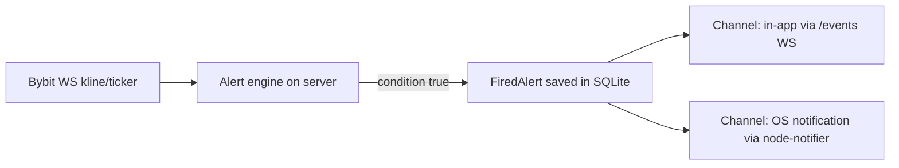

# Alerts
> [!abstract] TL;DR
> Price and indicator alerts evaluated by the local server on Bybit live data; fire in-app and as a macOS notification even when the tab is closed (server must run). Telegram channel later.

## 2. Scope

| In | Out |
|---|---|
| Price crosses / above / below value | Complex multi-condition alerts |
| Price crosses a drawn horizontal line or trendline | Alerts on private indicators |
| Indicator crosses value (e.g. RSI 14 > 70) on candle close | Webhooks |
| Once / every time, expiry | Telegram (later, `AlertChannel`) |
| Alerts list: create, pause, delete, history | |

## 3. How it works

- Price alerts check every ticker update; indicator alerts on **candle close** only (no repaint).
- Indicators for alerts computed on the server with the same formulas (shared TS implementation in `packages/core`; spot-check vs chart output).

## 6. Risks and mitigations

| Risk | Effect | Mitigation |
|---|---|---|
| Server not running | Alert missed | Banner in app "alerts paused"; later run server as a launchd service |
| Duplicate firing after reconnect | Spam | Store last-fired candle time per alert |
| Server indicator ≠ chart indicator | Wrong alert | Unit tests on fixed candle set comparing both |

## 9. Definition of done
- [ ] Price alert fires within 2 s of the cross, tab closed
- [ ] RSI alert fires on candle close only, once per candle
- [ ] Line-cross alert from a drawn line works
