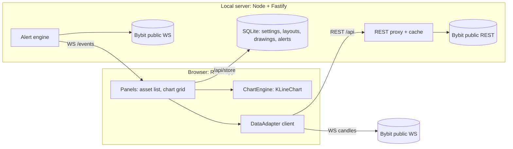

# Architecture & modules
> [!abstract] TL;DR
> React + TypeScript (Vite) web app + a tiny local Node/TS server in one monorepo. Every capability is a module behind a typed extension point, so built-ins and future plugins (bot control, DSL, backtest) plug in the same way.

## 1. Purpose
Runs locally on the Mac now; designed so it can be published as open source and later talk to any bot over a protocol.

## 2. Scope

| In (MVP) | Out (later) |
|---|---|
| Web app on `localhost`, local server | Desktop shell (Tauri), Pi hosting |
| Bybit public market data | Private/keyed exchange APIs, other exchanges |
| Storage of layouts, drawings, settings, alerts | Cloud sync, multi-user |
| Extension points, built-in modules | Third-party plugin loading at runtime, bot protocol |
| EN/RU UI strings | Accessibility audit, more languages |

## 3. How it works



**Repo layout** (pnpm workspace):

```
providence/
  apps/web/        # React + Vite + TS
  apps/server/     # Fastify + TS, better-sqlite3
  packages/core/   # extension-point types, shared models (Candle, Symbol, Timeframe)
  packages/adapter-bybit/
  Notes/           # TASKS.md, LOG.md, STATUS.md
```

## 4. Extension points (`packages/core`)

```ts
interface DataAdapter {            // market data source
  id: string                       // "bybit"
  listSymbols(): Promise<SymbolInfo[]>
  getCandles(q: { symbol: string; tf: Timeframe; to?: number; limit: number }): Promise<Candle[]>
  subscribeCandles(symbol: string, tf: Timeframe, cb: (c: Candle) => void): Unsubscribe
  getTickers(): Promise<Ticker[]>  // price, 24h change, volume
}
interface IndicatorDef { id: string; pane: 'overlay' | 'separate'; params: ParamSchema; template?: unknown /* KLineChart IndicatorTemplate */ }
interface DrawingTool  { id: string; label: string; group: 'lines'|'fib'|'forecast'|'annotate'; template?: unknown /* KLineChart OverlayTemplate; absent = built-in */ }
interface Panel        { id: string; title: string; component: React.FC }
interface AlertChannel { id: string; send(a: FiredAlert): Promise<void> }   // "local", later "telegram"
```

Rule: **app code never imports `klinecharts` directly**, only `ChartEngine` (in `apps/web/src/chart/`). Keeps the library swappable.

Data model: `Candle = { t: number /*ms open time*/, o, h, l, c, v: number }`, `Timeframe = '1m'|'5m'|'15m'|'1h'|'4h'|'1d'|'1w'`.

## 5. Benefits and drawbacks
> [!success] Benefits
> - Server from day one solves CORS, alerts while tab closed, and storage in one place.
> - Same interfaces for built-ins and plugins → the open-source plugin story is real, not retrofitted.

> [!failure] Drawbacks
> - Two processes to run (mitigated by one `pnpm dev` command).
> - Interfaces defined before the second implementation exists may need changes.

## 6. Risks and mitigations

| Risk | Effect | Mitigation |
|---|---|---|
| KLineChart v10 is beta; APIs differ from 9.x | Wrong docs/examples used | Pin exact `klinecharts@9.x` version; use v9 docs only (v9.klinecharts.com); all calls inside `ChartEngine` |
| Bybit rate limits on proxy | 403/10006 errors | Server-side cache (symbols 1 h, closed candles forever in SQLite), backoff |
| Private data leaks into the public repo | Strategies/results published | No private modules in MVP; `.gitignore` `data/`, `*.db`; `CLAUDE.md` rules copied from Tradebot |
| Server reachable from LAN | Anyone at home edits settings | Bind to `127.0.0.1` only |

## 7. Configuration
`apps/server/config.json` (gitignored, example committed): `port` (default 4317), `dbPath` (`./data/providence.db`), `bybit.restHost` (`https://api.bybit.com`). No keys anywhere.

## 8. Code references
Repo `~/Projects/providence` (to create in P0).

## 9. Definition of done
- [ ] `pnpm dev` starts web + server; app loads at `http://localhost:5173`
- [ ] Server listens only on 127.0.0.1
- [ ] All extension-point types exist in `packages/core` and the Bybit adapter implements `DataAdapter`
- [ ] No direct `klinecharts` import outside `chart/`

## 10. Alternatives considered
- Browser-only + Vite proxy: simpler, but alerts die with the tab and storage is per-browser.
- Svelte: lighter, but React chosen ([[UI SPEC]] §3).
- night-vision-js: navy-script is nice, but no drawing tools and an unfinalized API → [[ADR-P01 KLineChart as chart library]].

## 11. Open questions
- [ ] License for the repo (MIT vs Apache-2.0) — before publishing.
