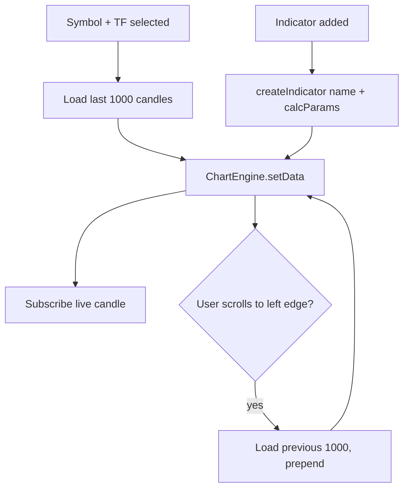

# Chart: candles, timeframes, indicators, layouts
> [!abstract] TL;DR
> KLineChart 9.x candle chart with timeframe switch, zoom/scroll with history paging, up to ~10 built-in indicators (overlay or own pane) with editable params, custom indicators as TS files via `registerIndicator`, and 1/2/4-chart layouts. Visual reference: [Figma](https://www.figma.com/design/z11rd8MMrhW463jnwQgGVy/Tradebot?node-id=0-1) (reference only, no effects).

## 1. Purpose
Covers TradingView features 1, 2 and 4 from [[UI SPEC]] §5: browse history on any timeframe, place/manage indicators, simple custom indicators.

## 2. Scope

| In | Out |
|---|---|
| Timeframes 1m 5m 15m 1h 4h 1d 1w | Custom/seconds timeframes, Heikin-Ashi, Renko |
| Scroll back with lazy loading, "go to date" | Bar replay |
| Built-in indicators: EMA, SMA, BB, VWAP (overlay); RSI, MACD, Stoch, ATR, Volume (pane) | Private indicators (never in this repo) |
| Indicator params dialog, show/hide, remove | Indicator-on-indicator |
| Custom indicators as TS modules (`registerIndicator`) in `packages/indicators` | Runtime-loaded user scripts, online library |
| Layouts 1, 2 (side by side), 4 (grid); per-cell symbol+tf; sync crosshair optional | Floating windows |
| Dark theme; EN/RU strings | Light theme (Could) |

## 3. How it works



**Chart state** (saved per layout cell on the server):

```ts
type ChartState = { symbol: string; category: 'linear'|'spot'; tf: Timeframe;
  indicators: { id: string; params: Record<string, number|string>; visible: boolean }[];
  drawings: DrawingShape[] }
```

## 4. Rules
- Max **10** indicators per chart (warn above).
- Keep max **50 000** candles in memory per chart; history loaded on demand via KLineChart's load-more callback.
- TF switch keeps the current right-edge time in view.
- Custom indicators: TS files in `packages/indicators/`, registered at startup and listed in the picker. Private indicators never go into this repo.

## 5. Benefits and drawbacks
> [!success] Benefits
> Built-in indicators (MA, EMA, BOLL, SAR, VOL, MACD, KDJ, RSI, …) cost nothing; custom ones are plain TS.

> [!failure] Drawbacks
> Some docs/examples are Chinese-first; v10 beta docs differ from v9 → use v9 docs only.

## 6. Risks and mitigations

| Risk | Effect | Mitigation |
|---|---|---|
| A needed indicator is not built in (e.g. VWAP, ATR) | Gap vs TradingView | Write it with `registerIndicator` (P4 includes one) |
| Performance with 4 charts × live WS | Laggy UI | One WS connection, multiplexed subscriptions; throttle redraw to animation frame |
| Indicator mismatch vs TradingView | Wrong analysis | Spot-check EMA/RSI on BTCUSDT 1h against Bybit's own chart |

## 9. Definition of done
- [ ] Open any symbol, switch all 7 TFs, scroll back ≥ 1 year on 1h smoothly
- [ ] Add/edit/hide/remove ≥ 5 built-in indicators, overlay and pane
- [ ] A custom indicator from `packages/indicators` shows up and works
- [ ] 2- and 4-chart layouts; state restored after reload

## 11. Open questions
- [ ] Exact built-in indicator list of the pinned version — check in P4, adjust table.
