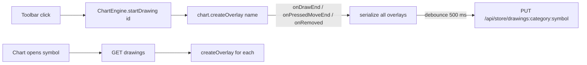

# Drawing tools
> [!abstract] TL;DR
> Use KLineChart's built-in overlays (lines, channels, Fibonacci, annotations) and add missing tools (long/short position, price/date range) as custom overlays via `registerOverlay`. A toolbar on the left of each chart, drawings saved per symbol.

## 1. Purpose
TradingView feature 5 ([[UI SPEC]] §5): long/short forecasting, lines, Fibonacci, annotations.

## 2. Scope

| Group | Tools | Source |
|---|---|---|
| Lines | segment (trendline), ray, straight line, horizontal line/ray, vertical line, price line | built-in |
| Channels | parallel channel, price channel | built-in |
| Fibonacci | retracement (fibonacciLine) + others the pinned version ships | built-in (verify list) |
| Forecast | **Long position**, **Short position** (entry, stop, take, R:R, %) | custom `registerOverlay` |
| Forecast | Price range, date range (Δ price, %, bars, time) | custom |
| Annotate | text/annotation, tag, arrow | built-in where available, else custom |

> [!important] Verify
> Exact built-in overlay names differ between versions — list them from the pinned 9.x build (`getSupportedOverlays()`) in P5 and fix this table.

## 3. How it works

- Stored in data coordinates (`points: { timestamp, value }[]`) + `name`, `styles`, `extendData` → survive zoom, scroll and TF switch.
- Drawings are **per symbol, shared across timeframes** (like TradingView).
- Select → small style bar: color, width, line style, text; Delete key removes; lock/hide all.

## 4. Formulas (Long/Short)
$$ R{:}R = \frac{|take - entry|}{|entry - stop|} \qquad \%_{stop} = \frac{stop-entry}{entry}\cdot 100 $$

> [!example] Worked example
> Long, entry 100, stop 95, take 115 → R:R = 15/5 = **3.0**, stop −5 %, take +15 %.

## 5. Benefits and drawbacks
> [!success] Benefits
> Most tools for free; interaction (handles, drag, magnet mode) handled by the library; custom tools are the same `DrawingTool` module type.

> [!failure] Drawbacks
> Built-in tool look is KLineChart's style; deep visual tweaks need custom overlays.

## 6. Risks and mitigations

| Risk | Effect | Mitigation |
|---|---|---|
| Built-in list differs from docs | Missing tool | Custom overlay for each gap |
| Custom overlay events differ in v9 vs v10 | Broken tools after upgrade | Stay on pinned 9.x; upgrade is its own task |

## 9. Definition of done
- [ ] All tools in §2 can be placed, moved, edited (style/text), deleted
- [ ] Long/Short shows R:R and % live while dragging
- [ ] Drawings survive reload, zoom and TF switch
- [ ] Undo last action (Ctrl/Cmd+Z)
