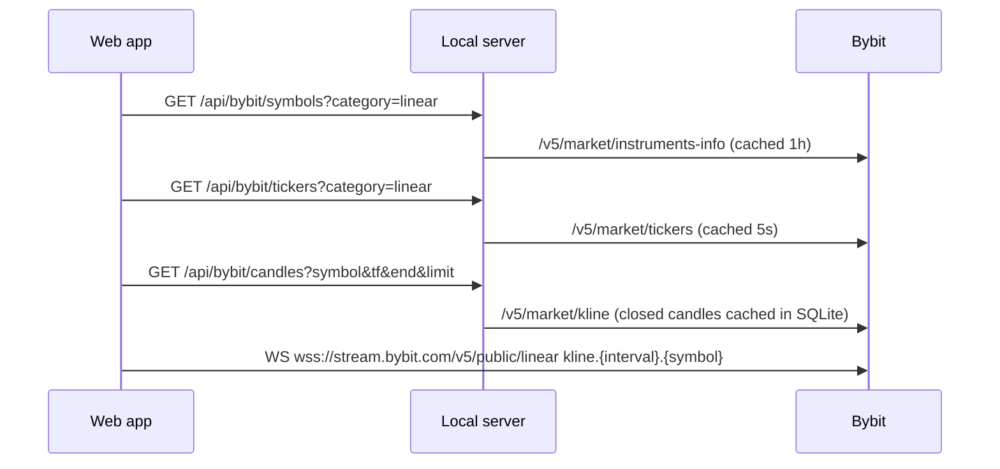

# Market data & asset list
> [!abstract] TL;DR
> Bybit public data (no keys): symbol list with price, 24h change and volume in a sortable/searchable table; history via the local server proxy; live candles via Bybit public WebSocket.

## 1. Purpose
Replace TradingView's watchlist/screener table and its data feed for crypto.

## 2. Scope

| In | Out |
|---|---|
| Bybit `linear` (USDT perps) and `spot` | Inverse, options |
| Table: symbol, last price, 24h %, 24h turnover, 24h volume, funding (linear) | Fundamentals, stocks/ETF (Massive later) |
| Search, sort, favourites (stored on server) | Custom screener formulas |
| History paging when scrolling back | Tick data, order book |

## 3. How it works

> [!important] Verify against the docs
> Endpoint names, params and limits must be checked at https://bybit-exchange.github.io/docs/v5/intro during P1 (kline returns max 1000 rows, newest first; check CORS from the browser once and log the result).

## 4. Rules
- Timeframe → Bybit interval: `1m→1, 5m→5, 15m→15, 1h→60, 4h→240, 1d→D, 1w→W`.
- Bybit returns candles newest-first as strings → adapter returns oldest-first numbers.
- Only **closed** candles are written to the cache; the forming candle comes from WS (`confirm=false`).
- Paging back: request `end = oldestLoaded.t - 1`, `limit = 1000`.

## 5. Benefits and drawbacks
> [!success] Benefits
> Free, no account needed; cache makes reloading and scrolling back fast.

> [!failure] Drawbacks
> Bybit only; spot and linear symbols with the same name must be kept apart (`category` is part of the symbol key).

## 6. Risks and mitigations

| Risk | Effect | Mitigation |
|---|---|---|
| WS disconnect | Stale chart | Auto-reconnect with backoff, ping every 20 s, refetch gap via REST, "stale" badge |
| Rate limit | Empty table | Cache + backoff; tickers polled max every 5 s |
| Bybit unreachable | Nothing to show | Show cached data + warning banner ([[UI SPEC]] §7) |

## 7. Configuration
Default category `linear`; default favourites `BTCUSDT, ETHUSDT`.

## 9. Definition of done
- [ ] Table lists all linear symbols with live-ish ticker data, search and sort work
- [ ] Favourites persist across restarts
- [ ] Candles for any symbol/tf load via server; second load comes from cache
- [ ] Live candle updates via WS; reconnect works after network off/on

## 11. Open questions
- [ ] Stocks/ETF source (Massive free tier vs others) — after MVP.
